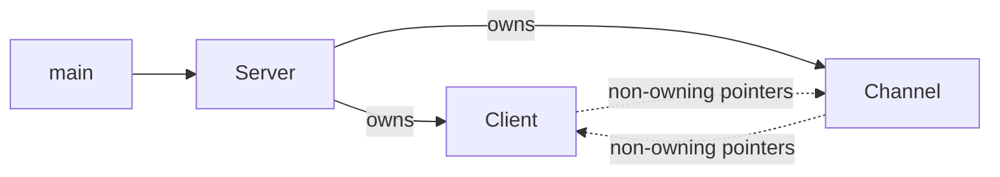
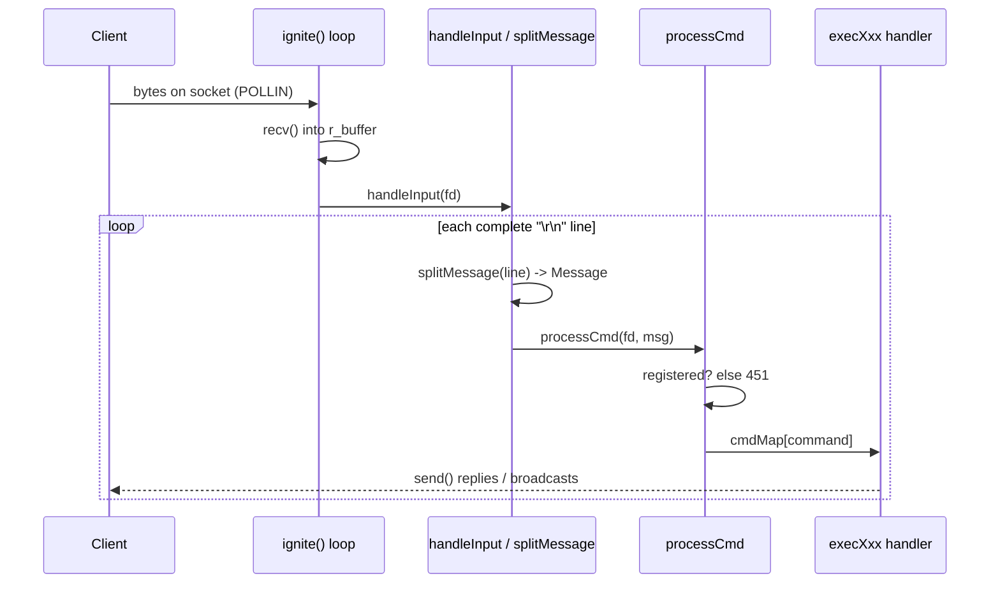

# Architecture

`ircserv` is a single-threaded server built around one `poll(2)` loop. All
state lives in a `Server` object created in `main.cpp`.

## Lifecycle (`main.cpp`)

1. `Server(ac, av)` validates `<port> <password>` and fills the command and
   reply tables.
2. `ascend()` creates the listening socket (`SO_REUSEADDR`, `bind`, `listen`).
3. `ignite()` runs the event loop until SIGINT.
4. `nuke()` closes every socket and frees all clients and channels.

Errors are thrown as `std::exception` and printed by `main`.

## Event loop (`Server::ignite`)

`poll_fds` is a `std::vector<pollfd>`; index 0 is the listening socket. The
loop calls `poll(..., -1)` and walks the vector:

- `POLLIN` on the listener calls `acceptClient()`, which sets `O_NONBLOCK`,
  creates a `Client` and appends its fd to `poll_fds`.
- `POLLIN` on a client calls `processClient(i)`, which `recv`s up to 1024
  bytes into that client's `r_buffer`, then `handleInput(fd)`.
- `recv` returning `<= 0`, or `POLLERR/POLLHUP/POLLNVAL`, calls
  `disconnectClient()`.

`disconnectClient` removes the fd from `poll_fds`, so it sets a flag
(`c_banished`) and the loop does `i--` to avoid skipping the element that
shifted into the slot. SIGINT sets `g_flag = 0`, which ends the loop.

## Parsing (`src/Parsing.cpp`)

TCP is a byte stream, so each client has a `r_buffer`. `handleInput` extracts
every complete line ending in `\r\n` and leaves any partial line in the
buffer for the next `recv`.

`splitMessage` turns a line into a `Message { command, params, trailing }`:

1. Text after the first `" :"` is the **trailing** argument (it may contain spaces).
2. The rest is split on whitespace: the first word is the **command**
   (upper-cased), the remaining words are **params**.

There is no support for message prefixes or tags. After each command,
`handleInput` checks that the client still exists (a handler such as `QUIT`
may have disconnected it) and stops if not.

## Dispatch (`src/ProcessCmd.cpp`)

`cmdMap` maps a command name to a pointer-to-member `void (Server::*)(int, Message)`.
`processCmd` first rejects unregistered clients with `451` for anything other
than `PASS`, `NICK`, `USER`, `CAP`, then calls the handler, or replies `421`
for unknown commands. Each handler lives in its own file under `src/cmds/`.

## Clients (`Client`)

One `Client` per connection, stored in `Server::clients` keyed by fd. It holds
nickname, username, realname, IP, the receive buffer, the registration flags
(`has_pass`, `has_nick`, `has_user`, `isRegistered`) and a map of joined
channels. `getPrefix()` returns `:nick!user@ip`, used as the source of
relayed messages.

Registration is complete when all three flags are set (`registerClient`),
whichever order they arrive in, at which point `001` is sent. A wrong `PASS`
disconnects the client immediately.

## Channels (`Channel`)

Channels live in `Server::channels`, keyed by name. A `Channel` has:

- `members` and `operators`: `fd -> Client*` maps
- `inviteList`: fds invited while the channel is `+i`
- topic, key, member limit, and the `i`/`t`/`k` flags

The first member to join an empty channel becomes operator. A channel is
deleted when its last member leaves, is kicked, or disconnects. `Channel`
only keeps pointers to clients; the `Server` owns and deletes them.

Helpers: `addClient` (adds the member, broadcasts `JOIN`, sends topic and
`353`/`366` name list), `removeClient`, `broadcast` (sends `:prefix message`
to all members, optionally skipping the sender) and `operatorsBroadcast`
(used for `@#channel` messages).

### Modes

`execMode` parses the mode string left to right, tracking the current `+`/`-`
sign and an index into the argument list. Each mode letter calls a setter
(`modeI`, `modeK`, `modeL`, `modeO`, `modeT`) which changes state and appends
only the changes that actually happened to a `modeBroadcast`
(`modes`, `args`, `unknown`). The combined result is then broadcast once to
the channel, and unknown letters are reported to the sender.

## Replies

Numeric replies go through `Server::sendReply(fd, code, middle)`, which
formats `:localhost <code> <nick> [middle] :<text>` with the text taken from
`replyMap`. Some messages (JOIN, MODE, relayed PRIVMSG, topic and names
lists) are built directly with `send`. Codes are `#define`d in
`includes/utils.hpp`.

## Bot

`!artbot` in a `PRIVMSG` to a channel the sender belongs to is intercepted in
`execPrivmsg` instead of being relayed; `execBot` picks one of six pictures at
random and sends it line by line to the requester only.
